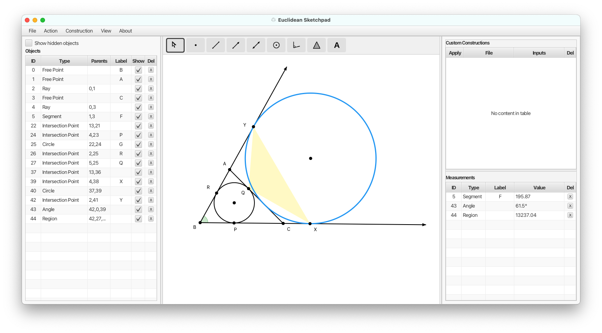

<p align="center">
  
</p>

<h1 align="center">Euclidean Sketchpad</h1>

<p align="center">
  A desktop application for creating geometric constructions using compass and straightedge.
</p>



## Features

- **Compass-and-straightedge tools** — construct points, lines, rays, segments, circles, angles, and regions
- **Dynamic geometry** — drag free points and watch the entire construction update in real time
- **Intersection detection** — automatic intersection previews between lines and circles
- **Measurements** — measure segment lengths, angles, circle circumferences, and region areas
- **Custom constructions** — record a sequence of steps, save it, and reapply it with different inputs
- **Built-in constructions** — midpoint, parallel line, perpendicular line, and reflection point
- **Export** — save diagrams as PNG or SVG with canvas, custom bounding box, or auto-fit methods
- **Undo/redo** — full snapshot-based undo history

## Download

Download the latest release from the [Releases](https://github.com/cartowong/euclidean-sketchpad/releases) page.

### macOS

Download the `.dmg` file, open it, and drag **Euclidean Sketchpad** to your Applications folder.

> **Note:** The app is not code-signed. On first launch, you may need to right-click the app and select "Open", then click "Open" in the dialog to bypass Gatekeeper.

### Windows / Linux

Pre-built installers are not yet available. See [Building from Source](#building-from-source) below.

## Building from Source

> The rest of this README is for developers who want to build the project from source. If you just want to use the app, download the installer from the [Releases](https://github.com/cartowong/euclidean-sketchpad/releases) page above.

### Prerequisites

#### Java Development Kit (JDK) 21

The project requires **JDK 21** or later.

**macOS** (via [Homebrew](https://brew.sh)):

```bash
brew install openjdk@21
```

After installing, follow the instructions Homebrew prints to symlink it, or add it to your `PATH`:

```bash
sudo ln -sfn $(brew --prefix openjdk@21)/libexec/openjdk.jdk /Library/Java/JavaVirtualMachines/openjdk-21.jdk
```

**Windows** (via [winget](https://learn.microsoft.com/en-us/windows/package-manager/winget/)):

```powershell
winget install EclipseAdoptium.Temurin.21.JDK
```

**Linux** (Debian/Ubuntu):

```bash
sudo apt install openjdk-21-jdk
```

Verify the installation:

```bash
java -version
```

You should see output indicating version 21 or later.

#### Gradle

You do **not** need to install Gradle separately. The project includes the Gradle Wrapper (`gradlew` / `gradlew.bat`), which automatically downloads the correct Gradle version on first run.

### Run the application

```bash
./gradlew run
```

On Windows, use `gradlew.bat run` instead.

### Run the tests

```bash
./gradlew test
```

### Package as a native installer

To build a macOS `.dmg` installer:

```bash
./gradlew jpackage
```

The output will be at `build/jpackage/EuclideanSketchpad-1.0.0.dmg`.

To build just the `.app` bundle (faster, useful for testing):

```bash
./gradlew jpackageImage
```

The output will be at `build/jpackage/Euclidean Sketchpad.app`.

## Changelog

See [CHANGELOG.md](CHANGELOG.md) for the version history.

## License

This project is licensed under the [MIT License](LICENSE).
